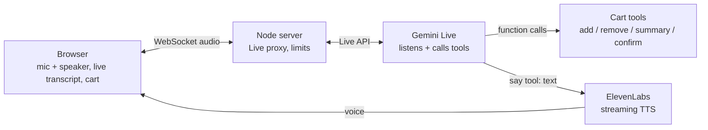

# Voice Ordering Agent — real-time AI operator for call centers (case study)

> Product demo I built to sell AI voice operators to fast-food chains, hotels, and sales/support call centers. The demo scenario is fast-food phone ordering. Source code is private; this document covers architecture, agent design and how quality was measured.

**Role:** AI Engineer (design and build)
**Stack:** Node.js · TypeScript · Express + WebSocket · React + Vite + Tailwind · Google Vertex AI **Gemini Live** (function calling) · ElevenLabs streaming TTS

## What it does

The caller presses **Call** in the browser and talks to the AI operator in **Uzbek, Russian or English**. The operator:
- recommends items from a real ~100-item menu (14 categories) and suggests add-ons;
- builds the cart by calling tools and reads totals only from tool results, never invented;
- collects customer details, confirms the order and shows the receipt;
- stops talking immediately when the caller interrupts (barge-in) and steers back after off-topic questions.

## Architecture

- **Gemini Live** handles listening, turn-taking and tool calls. The reply is sent to a `say` tool as text and spoken by **ElevenLabs** for a natural Uzbek voice. If ElevenLabs is not configured, the server falls back to Gemini's own voice.
- **Operator identity and sales method** live in an editable `SOUL.md`; a JSON **pronunciation dictionary** fixes brand names, sizes and numbers.
- **Public-demo protection:** concurrent-session cap, optional per-IP and daily limits, 5-minute sessions, 60-second silence timeout, optional access code. Provider keys stay on the server.

## Measured iteration (sales-quality eval)

An LLM plays the customer and a judge scores the full call on 8 criteria × 0–2 = **16 points**.

| Run | Change | Score / 16 |
|---|---|---|
| 01 | baseline | 12.06 |
| 02 | baseline v2 | 12.50 |
| 03 | pronunciation dictionary | 13.00 |
| 04 | SOUL (operator identity + sales method) | 13.75 |
| 05 | no free-form reply when speaking through `say` | **14.69** |
| 06 | literary style | 14.63 |
| 07 | sales jargon | 13.38 ↓ reverted |
| 08 | no praise, lighter jargon | 14.00 |

**12.06 → 14.69 / 16**, and every change was kept or reverted based on the measured score.

## Testing

- Unit tests for the cart, tools and rate limiter.
- Smoke tests for the model with tool calling and for a full text-only order in each language.
- **Headless-browser end-to-end test with a fake microphone**, fed with generated customer speech.

## Where it applies

The same pattern — real-time voice, tool calling against the business's own data, an editable identity and sales method, and eval-driven tuning — carries over to hotel bookings, sales calls and support lines.
